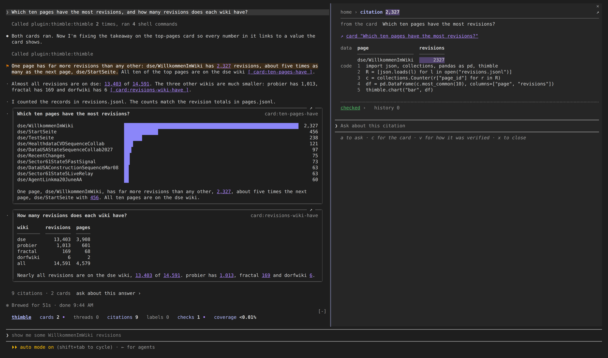

<p align="center"></p>

**thimble** is an open source Claude Code plugin for human oversight. It opens a workbench where you and Claude make sense of large volumes of agent output together.

> [!CAUTION]
> - **thimble is in alpha.** It changes daily, so expect bugs and rough edges.
> - **thimble is not an official Anthropic product.**

For feedback, bug reports, or anything else, please reach out to [@mjoerke](https://github.com/mjoerke). I would love to hear from you!

## Demo

https://github.com/user-attachments/assets/e8b0c9d8-1bc0-4ccb-a5ac-4c311cea02d4

## Installation

### Quickstart (with Claude)

```
claude "install thimble from https://github.com/safety-research/thimble"
```

Instructions for agents installing thimble on the user's behalf are in [CLAUDE.md](CLAUDE.md).

### Manual

1. Download the zip from the [latest release](https://github.com/safety-research/thimble/releases/latest).
2. Unzip it.
3. Run `bash scripts/install.sh` inside the unzipped folder.

For a development build, clone the repo and run `bash scripts/install.sh`. [INSTALL.md](INSTALL.md) covers requirements, updating and troubleshooting.

## Usage

Run `thimble` in a directory with files you'd like to analyze, just like you would run `claude`.

- It starts a Claude Code session there with the thimble plugin loaded, inside thimble's sandbox, and prints the dashboard URL.
- Each run starts a new conversation on the same workspace (cards, report, labels). `thimble --continue` picks up your last conversation in this folder instead.

### Terminal mode

In terminal mode, thimble operates as a Claude Code mod and shows its work directly in the terminal, with no server or browser.



To switch a directory to terminal mode, run `thimble mode terminal` in it, then `thimble`. `thimble mode browser` switches it back.

## Commands

**Inside a Claude Code session**

| Command | What it does |
|---|---|
| `/thimble` | start the thimble server and print the dashboard URL |
| `/thimble fresh` | archive this workspace and open an empty one |
| `/thimble restore [<name>]` | bring an archived workspace back |
| `/thimble:orient [focus]` | start an orientation |
| `/thimble:label <name> [definition]` | define a label and apply it to the records |
| `/thimble:write [report\|slides\|story] [request]` | start a writer on a document |

**From a shell** (`thimble help` lists every command)

| Command | What it does |
|---|---|
| `thimble` | start thimble in this folder; `thimble -c` continues the last session |
| `thimble demo` | download the [demo datasets](demos/README.md) and open them in the browser |
| `thimble mode browser\|terminal` | show thimble's work in the browser or in the terminal |
| `thimble list`, `thimble purge <id>` | list the workspaces, or delete one |
| `thimble doctor` | show what is installed and running, and what is wrong |
| `thimble feedback` | write a problem report (a zip) |
| `thimble update`, `thimble uninstall` | update to the latest release, or uninstall |

## Requirements

Claude Code (tested with 2.1.295), with its hooks modules on, macOS or Linux, and Python 3.12+ ([uv](https://docs.astral.sh/uv/) recommended). Node 20+ is needed for custom views (the viewers the dev agent builds for your data), for the sandbox card code and code tickets run in, and for a development build. [INSTALL.md](INSTALL.md) has the details.

## Security

thimble is a research prototype. Its server has no login, so any program on your machine can use it, and Claude's notebook code can reach the network and local services: treat a corpus like code you are about to run. Report security issues privately to [@mjoerke](https://github.com/mjoerke).

## License

Apache-2.0; see [LICENSE](LICENSE).
