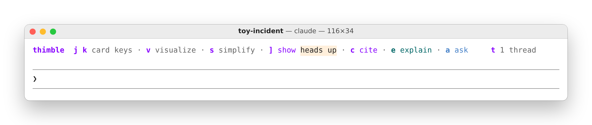
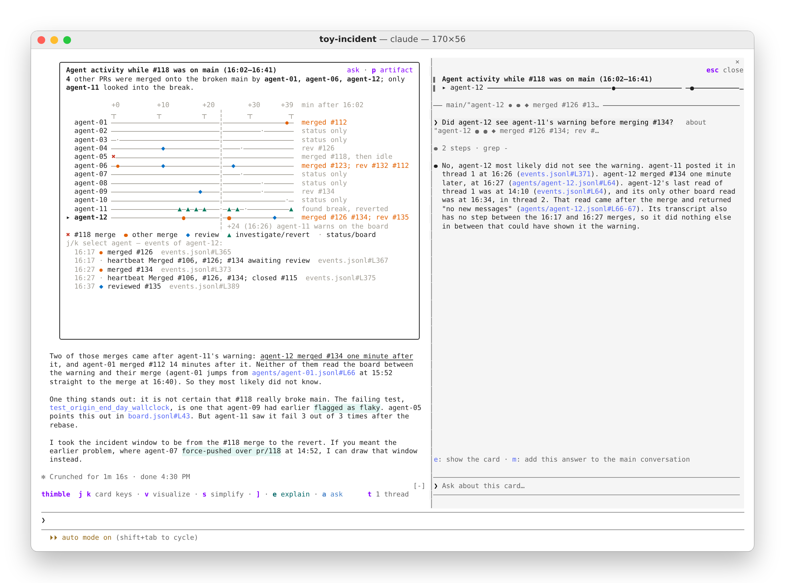
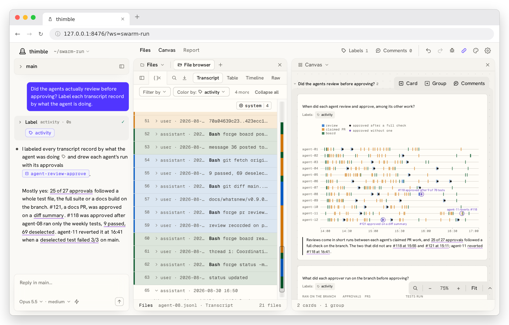

<p align="center"></p>

**thimble is a Claude Code plugin that makes it easy to understand what agents did.** It gives Claude tools to cite, visualize and label your data, and gives you an interface to understand and verify Claude's work faster.

> [!CAUTION]
> - **thimble is a research prototype.**
> - **thimble is not an official Anthropic product.**

For feedback, bug reports, or anything else, please reach out to [@mjoerke](https://github.com/mjoerke). I would love to hear from you!

https://github.com/user-attachments/assets/66bb0218-868e-4bf5-947c-461d2eaab5d2

## Features



Press a key at an empty prompt, or click it:

- **`v` visualize**: an interactive card of the last answer
- **`s` simplify**: a shorter, plainer version of the last answer
- **`c` cite**: a second Claude checks the selected words against your files
- **`e` explain**: a short explainer of the selected words; thimble also adds explainers and heads-ups to each answer
- **`a` ask**: a side thread about the selected words or part of a card; `t` lists them

## Installation

### With Claude (recommended)

```
claude "install thimble from https://github.com/safety-research/thimble"
```

Agents installing thimble: follow [CLAUDE.md](CLAUDE.md).

### Manual installation

```
curl -fsSL https://raw.githubusercontent.com/safety-research/thimble/main/scripts/install.sh | bash
```

[INSTALL.md](INSTALL.md) covers the options and troubleshooting.

## Usage

### Terminal plugin

Run `claude` in a folder of files. Click `thimble` above the prompt to turn features on or off.



### Browser workbench

Run `thimble-browser` in a folder of files.



## Requirements

macOS or Linux (on Windows, WSL 2), with Claude Code, Python and Node.js.

## Security

thimble is a research prototype and may have security vulnerabilities. Report security issues privately to [@mjoerke](https://github.com/mjoerke).

## Contributing

To change how thimble works, type `/thimble-fix <what should work differently>`. Claude changes your own copy of thimble and tests it. Then, in a shell:

- `thimble fixes` lists your fixes.
- `thimble file pr N` opens a pull request with fix N (`thimble file issue N` gives an issue link instead).
- `thimble update` updates thimble and keeps your fixes.

To work on thimble's own code, see [CONTRIBUTING.md](CONTRIBUTING.md).

## License

Apache-2.0; see [LICENSE](LICENSE).
