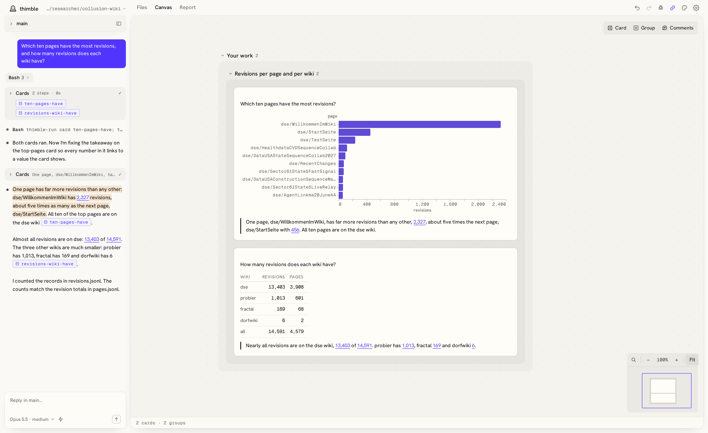

<p align="center"></p>

**thimble** is an open source Claude Code plugin for human oversight. It opens a workbench where you and Claude make sense of large volumes of agent output together. Where Claude Code answers in paragraphs that are hard to understand and verify, thimble answers visually, with charts and cards that cite every claim.

> [!CAUTION]
> - **thimble is in alpha.** It changes daily, so expect bugs and rough edges.
> - **thimble is not an official Anthropic product.**

For feedback, bug reports, or anything else, please reach out to [@mjoerke](https://github.com/mjoerke). I would love to hear from you!

## Demo

https://github.com/user-attachments/assets/e8b0c9d8-1bc0-4ccb-a5ac-4c311cea02d4

## Installation

### With Claude (recommended)

```
claude "install thimble from https://github.com/safety-research/thimble"
```
Instructions for agents installing thimble on the user's behalf are in [CLAUDE.md](CLAUDE.md).

### Manual installation

1. Download the zip from the [latest release](https://github.com/safety-research/thimble/releases/latest).
2. Unzip it.
3. Run `bash scripts/install.sh` inside the unzipped folder.

For a development build, clone the repo and run `bash scripts/install.sh`. See [INSTALL.md](INSTALL.md) for detailed installation instructions.

## Usage

Run `claude` in a folder with files you'd like to analyze. By default, thimble is enabled in every session. You can toggle
thimble on and off using `/plugin`.


Type `/thimble browser` to open the same session in the browser workbench.



## Commands

**Inside a Claude Code session**

| Command | What it does |
|---|---|
| `/thimble` | open thimble's panel in the terminal |
| `/thimble browser` | open the browser workbench on this session, signed in |
| `/thimble coverage`, `/thimble citations`, `/thimble checks` | open the panel at that section |
| `/thimble fresh` | archive this workspace and open an empty one |
| `/thimble restore [<name>]` | bring an archived workspace back |
| `/thimble:orient [focus]` | start an orientation |
| `/thimble:label <name> [definition]` | define a label and apply it to the records |
| `/thimble:write [report\|slides\|story] [request]` | start a writer on a document (in the browser workbench) |
| `/config` → thimble | turn single features on or off: view proposals, labels, checks, citation marks, coverage, card check |

**From a shell** (`thimble help` lists every command)

| Command | What it does |
|---|---|
| `thimble` | start Claude Code in this folder and open the browser workbench; `thimble -c` continues the last session |
| `thimble open` | open the browser workbench for this folder's running session |
| `thimble demo` | download the [demo datasets](demos/README.md) and open them in the browser |
| `thimble list`, `thimble purge <id>` | list the workspaces, or delete one |
| `thimble doctor` | a checklist of what is installed and running, with the fix for each problem (`--verbose` for the details) |
| `thimble unpair` | sign out every browser |
| `thimble feedback` | write a problem report (a zip) |
| `thimble update`, `thimble uninstall` | update to the latest release, or uninstall |

## Requirements

Claude Code (tested with 2.1.301), with its hooks modules on, macOS or Linux, and Python 3.12+ ([uv](https://docs.astral.sh/uv/) recommended). Node 20+ is needed for custom views (the viewers the dev agent builds for your data), for the sandbox card code and code tickets run in, and for a development build. 

## Security & Privacy

thimble is a research prototype. Please report any security issues privately to [@mjoerke](https://github.com/mjoerke). thimble runs on top of Claude Code: it does not collect any data of its own and all authentication and billing is managed by `claude`. It starts no Claude Code session of its own: its agents run as subagents of your session, in its permission mode, and its model calls through your session's own client.

## License

Apache-2.0; see [LICENSE](LICENSE).
